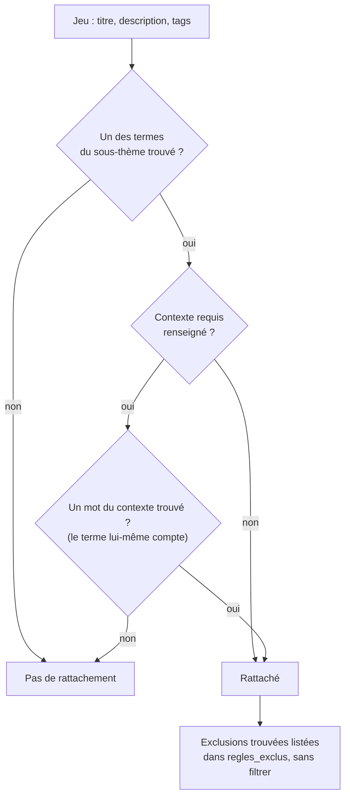

# Catalogage des données de mobilité de data gouv

Ce repo contient une documentation et des codes en vue de faire l'inventaire des
données open data du domaine Mobilité/Transport. Ce projet s'inscrit dans le
cadre du projet du projet MobSciDat Factory (contrat n°ANR-23-PEMO-0004). Ce
travail bénéficie d'une aide de l'Etat gérée par l'Agence Nationale de la
Recherche attribuée au project Mob Sci-Dat Factory au titre de France 2030
portant la référence ANR-23-PEMO-0004.

L'objectif final est de pouvoir créer un portail des données de mobilité,
complémentaire de transport data gouv, et de logistique data gouv, sur le
périmètre des données pour l'analyse des mobilités.

L'objectif technique à court terme est de pouvoir classer les données de
data.gouv en collections de données par thème métier (stationnement, voirie,
transport public, trafic routier, logistique et fret, vélo, marche,
accessibilité, mobilité partagée...) et par sous-thème dans chaque métier.

Le projet est
[documenté dans le wiki](https://github.com/CEREMA/catalogue-datagouv-mobi/wiki).

L'approche est de mettre en place un pipeline de traitement : sélection des jeux
de données du domaine mobilité/transport, puis, pour chaque thème :

1. sélection des jeux de données pertinents pour le thème
2. étiquetage des jeux de données par sous-thème
3. tests de la qualité des données pour quelques critères simples (date de mise
   à jour, etc.)
4. publication des collections de données par thème (dans un tableau Grist et/ou
   en tant que collection dans ecologie.data.gouv)
5. envoi de messages aux producteurs de données (retour sur la qualité des
   méta-données)

## Principe

Chaque jeu non archivé de data.gouv.fr (~75k) est rattaché à l'ontologie
(`data/ontology/ontologie_v3.csv`) de trois façons, stockées séparément :

- **mots-clés** (baseline, méthode historique) : un des `mots_cles_indicatifs`
  du sous-thème apparaît tel quel dans le jeu ;
- **règles** (tableau de classification du client) : un des `termes` du
  sous-thème (liste plus large) et un mot de son `contexte_requis` apparaissent
  dans le jeu ; les `exclusions` trouvées sont signalées ;
- **embeddings** : les `k` sous-thèmes de sens le plus proche, même sans mot
  commun, avec leur rang et leur distance
  ([bge-m3](https://huggingface.co/BAAI/bge-m3), PostgreSQL + pgvector).

Les faux amis sont signalés (mots exclus) ou écartés en enrichissant l'ontologie
(sous-thèmes de thème `contre_exemple`). Règles de rédaction et évolutions :
[JOURNAL.md](JOURNAL.md).

### Rattachement par règles

Pour chaque jeu (titre, description, tags) et chaque sous-thème :



Exemple, `stationnement/stationnement_en_voirie` :

- « Places de parking PMR de la Ville de Saint-Brieuc » est rattaché par règle
  (terme `places de parking`, contexte `parking`), mais pas par mot-clé : aucun
  des 4 mots-clés (`stationnement`, `horodateur`…) n'y figure, alors que les
  règles ont 22 termes ;
- « Places en crèche » n'est pas rattaché : terme `places`, mais aucun mot du
  contexte ;
- un terme est trouvé si tous ses mots sont présents, dans n'importe quel ordre
  (« Parking : nombre de places » trouve `places de parking`), un mot-clé
  seulement s'il apparaît tel quel.

### In code vs Grist

Pas d'aller-retour : le code calcule, Grist sert à décider.

- **Code** (rejouable) : rattachements des trois méthodes avec ce qui les a
  déclenchés (mots trouvés, rang, distance), sans seuil, filtrage ni agrégation.
  Données sur les jeux et producteurs : fraîcheur (comme la date "Mis à jour le"
  de data.gouv.fr), schémas, catégorie juridique (SIRENE). CSV de `data/grist/`.
- **Grist** (widgets et formules, pas de code versionné) : import
  (`rattachements.csv` en _Update existing records_ sur `jeu` + `sous_theme`),
  validation manuelle, règle métier (filtres sur distance, mots trouvés et
  exclus), vues par domaine et sous-thème, compteurs, publication.
- **Ontologie** : modifiée dans le CSV, par PR (voir plus bas).

## Installation

Prérequis : Docker et [uv](https://docs.astral.sh/uv/)
(`curl -LsSf https://astral.sh/uv/install.sh | sh`).

```bash
cp .env.example .env
make db-up       # PostgreSQL + pgvector (docker, port 5435)
make install
make test
```

## Utilisation

```bash
make update      # tout, rejouable (cron)
```

| Étape                 | Rôle                                                                                     |
| --------------------- | ---------------------------------------------------------------------------------------- |
| `make fetch`          | télécharge les derniers exports data.gouv.fr dans `data/catalog/`                        |
| `make embed`          | synchronise ontologie, jeux, métadonnées ; embeddings manquants                          |
| `make embed-ontology` | idem pour la seule ontologie (sans GPU, catalogue non relu)                              |
| `make attach`         | rattachements par mots-clés (baseline), par règles et par embeddings (`k` plus proches)  |
| `make enrich`         | catégorie juridique des producteurs (SIREN pas encore en cache)                          |
| `make export`         | tables pour Grist dans `data/grist/` : rattachements toutes méthodes, et une par méthode |
| `make short-export`   | idem, allégé pour l'import manuel dans Grist                                             |

Seuls les éléments nouveaux ou modifiés sont réembeddés.

Le premier calcul complet demande un GPU mais il ne doit avoir lieu qu'une fois.
Seul `embed` en a besoin :

```bash
# serveur GPU
make fetch && make embed && make dump-db
# en local
scp root@<serveur>:~/catalogue-datagouv-mobi/catalogue_mobi.dump .
make restore-db && make attach && make enrich && make export
```

## Modifier l'ontologie

L'ontologie est un CSV édité à la main, une ligne par sous-thème. L'id d'un
sous-thème est `theme/sous_theme` (slugs ASCII en `snake_case`) : c'est la clé
de jointure en base, dans les exports et des validations faites dans Grist
(`jeu` + `sous_theme`).

| Modification                                                         | Conséquence                                                             | À relancer                     |
| -------------------------------------------------------------------- | ----------------------------------------------------------------------- | ------------------------------ |
| Libellés (`*_label`)                                                 | aucune                                                                  | `export`                       |
| `mots_cles_theme`, `termes`, `contexte_requis`, `exclusions`         | rattachements par mots-clés et règles                                   | `attach export`                |
| `theme_description`, `description`, `mots_cles_indicatifs`           | sous-thème réembeddé, rangs et distances changent                       | `embed-ontology attach export` |
| Ajout d'un sous-thème                                                | nouvel id                                                               | `embed-ontology attach export` |
| Slug `theme` ou `sous_theme` changé, sous-thème supprimé ou fusionné | ancien id supprimé avec ses rattachements, validations Grist orphelines | `embed-ontology attach export` |

Règles :

- **`make embed-ontology`** suffit après une modification de l'ontologie : seuls
  les sous-thèmes dont le texte a changé sont réembeddés, en une vingtaine de
  secondes sur CPU. Les jeux de données ne sont ni relus ni réembeddés.
- **Ne jamais renommer un slug** pour changer un intitulé : modifier le libellé.
  Une fusion garde l'id du sous-thème qui absorbe l'autre, et la correspondance
  ancien id → nouvel id est notée au JOURNAL pour reporter les validations dans
  Grist.
- **Un nouveau fichier `ontologie_vN.csv`** seulement quand les colonnes
  changent (et `ONTOLOGY_PATH` dans `constants.py`). Sinon, modification sur
  place : git sert d'historique.
- **Une PR par modification métier**, avec une ligne au JOURNAL (quoi, pourquoi,
  jeux constatés). Côté contenu, voir les règles de rédaction des descriptions
  au JOURNAL (méthode par embeddings).
- **Mots-clés** : sans casse ni accents, tirets lus comme des espaces, mots
  trouvés en début de mot avec jusqu'à deux lettres de plus (pluriels).
  Séparateur `,` dans les colonnes `mots_cles_*`, `;` dans les colonnes de
  règles (comme le tableau source, dont des termes contiennent des virgules).
- **Règles** : un terme est trouvé si tous ses mots sont présents, dans
  n'importe quel ordre (mots vides et mots d'une lettre ignorés). Il rattache si
  un mot de `contexte_requis` est trouvé (lui-même compris), ou seul si
  `contexte_requis` est vide. Les `exclusions` trouvées sont signalées, sans
  filtrer. Contexte et exclusions sont ceux de la catégorie du tableau source,
  recopiés sur chacun de ses sous-thèmes.

## Données

| Dossier          | Contenu                                                                                                    | Versionné |
| ---------------- | ---------------------------------------------------------------------------------------------------------- | --------- |
| `data/catalog/`  | exports data.gouv.fr                                                                                       | non       |
| `data/ontology/` | ontologie (source éditée à la main)                                                                        | oui       |
| `data/grist/`    | tables à importer dans Grist                                                                               | non       |
| `data/old/`      | sorties de l'ancienne approche (notebooks `old/`), tableau de classification du client (source des règles) | oui       |

## Inspiration de FlowDataGouv

<https://github.com/FLI-GCT/FlowDataGouv> est un démonstrateur développé en mars
2026 par Guillaume Clément à l'occasion de la publication du serveur MCP de
data.gouv.fr. L'idée est d'utiliser le serveur MCP pour classer, étiqueter et
nettoyer les 75k datasets de data.gouv et proposer un site alternatif à
data.gouv pour accéder. Le site a été fermé après 1 mois (PoC). Dans ce projet
(dont le code a été généré par claude), les principales données des datasets de
data.gouv sont récupérées via l'API et mises dans un dataframe (code en
typescript : src/lib/sync/catalog.ts), et enrichies par Mistral AI (catégorie,
sous-catégorie, zone géographique, résumé, score qualité — voir
enrichBatchMistral). Un contrôle qualité des datasets et ressources est
également effectué, avec calcul d'indicateurs de qualité (en python).
